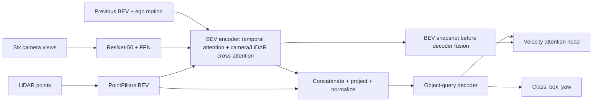

# BEVFormerFusion

**Camera-LiDAR 3D object detection with PointPillars and spatiotemporal BEV transformers.**

BEVFormerFusion studies where LiDAR geometry should enter a BEVFormer detector. It retains the multi-view camera and temporal BEV pipeline, adds a PointPillars LiDAR branch, and combines encoder-side cross-modal attention with fusion before the detection decoder. On the recorded nuScenes validation experiments, the full **Enc_Dec** model reaches **0.2507 mAP / 0.2546 NDS**, compared with **0.2011 / 0.2192** for the local camera-only baseline.

This repository contains the BEVFormerFusion implementation, technical documentation, experiment summaries, and the project report. The report also covers **FusionPointPillars**, a separate pillar-level fusion study on KITTI; its implementation and KITTI results are outside this repository's scope.

[Project report (PDF)](reports/From%20Pillars%20to%20Transformers%3A%20Two%20Fusion%20Paradigms%20Based%20on%20PointPillars%20for%203D%20Object%20Detection.pdf) · [Technical documentation](doc/index.md) · [Experiment data](results/README.md) · [Active configuration](projects/configs/bevformer/bevformer_project.py)

## Research context

LiDAR provides geometric measurements, while cameras supply appearance and semantic cues. A shared bird's-eye-view representation enables the two modalities to contribute to spatially aligned detection. This project investigates two insertion points within the transformer pipeline: cross-modal attention during BEV encoding and a direct LiDAR feature path before object-query decoding.

The accompanying report is **From Pillars to Transformers: Two Fusion Paradigms Based on PointPillars for 3D Object Detection**, by Le Shen, Pavithra Mahadevappa Girithimmappa, Sanghee Suh, and Xiaotong Wu, San José State University, April 2026. Sections 3.2, 4.2, and 7.2 describe this repository's method, evaluation, and future work.

## Method



- **Encoder-side fusion.** Each `MM_BEVFormerLayer` combines camera spatial cross-attention with deformable attention over projected LiDAR BEV tokens. A learned scalar sigmoid gate in each layer blends the responses.
- **Decoder-side fusion.** LiDAR BEV features are resized and projected, concatenated with encoder BEV tokens, and compressed from `2C` to `C`, followed by layer normalization. The linear layer starts with identity weights for the encoder half and zero weights for the LiDAR half.
- **Orientation and velocity heads.** Yaw uses separate bin and residual predictions. A dedicated velocity head attends from decoder queries to `bev_embed_cam`, a snapshot taken **before decoder-side fusion**. In Enc_Dec, this snapshot already contains encoder-side LiDAR information; it is not a purely camera-only representation.
- **Temporal processing.** Camera BEV history is reconstructed without gradients and aligned using temporal attention and ego-motion metadata. The LiDAR branch uses the current point cloud.

The transformer supports `none`, `decoder`, `encoder`, and `encoder_decoder` fusion modes. The active configuration uses `encoder_decoder`. Changing this flag alone does not reconstruct every historical experiment: the baseline and Decoder/V3 also require their original model, data, and training settings.

### Relation to BEVFormer

| Component | Upstream-style local reference | Active BEVFormerFusion configuration |
| --- | --- | --- |
| Inputs | Multi-view cameras | Cameras + LiDAR |
| Camera backbone | ResNet-101 with DCNv2 | ResNet-50 + FPN |
| BEV grid / object queries | `200 x 200` / `900` | `100 x 100` / `450` |
| Encoder / decoder depth | `6 / 6` | `4 / 6` |
| Encoder cross-attention | Camera spatial attention | Camera and LiDAR attention with learned blending |
| Decoder context | Encoder BEV | Encoder BEV + projected LiDAR BEV |
| Prediction | Standard box channels | Separate yaw bin/residual and velocity heads |

The reference column describes [`bevformer_base.py`](projects/configs/bevformer/bevformer_base.py), not the lightweight experimental baseline described in the report. The report states that its baseline shares the fusion model's backbone, `100 x 100` BEV grid, and schedule; the exact baseline experiment configuration is not included here. The recorded baseline results should therefore not be attributed to the checked-in R101 reference configuration.

## Results on nuScenes validation

Checkpoints are selected by validation NDS. Higher is better for mAP and NDS; lower is better for the error metrics. These are local research results, not official upstream BEVFormer benchmark scores.

| Variant | Selected iteration | mAP | NDS | mATE | mAVE |
| --- | ---: | ---: | ---: | ---: | ---: |
| Camera-only baseline | 100,000 | 0.2011 | 0.2192 | 0.9490 | 1.0415 |
| **Enc_Dec** | **100,000** | **0.2507** | **0.2546** | **0.8697** | 1.1375 |
| Decoder-only (V3) | 90,000 | 0.202 | 0.214 | 0.872 | 1.139 |

The baseline and Enc_Dec values retain the precision of the preserved [checkpoint export](results/metrics.json). V3 values are transcribed at the precision of report Table 5 in [report_results.json](results/report_results.json).

At 100k iterations, Enc_Dec improves mAP by **+0.0496** and NDS by **+0.0354** (4.96 and 3.54 percentage points). Translation and attribute errors decrease, but velocity error increases from 1.0415 to 1.1375 and orientation error increases from 0.8150 to 0.8241. The dedicated velocity head does not establish an improvement in velocity accuracy in these runs.

Report Table 6 shows AP gains in nine of ten classes, with the largest gains for bus (+0.153), barrier (+0.082), car (+0.065), and truck (+0.062). Construction vehicle is unchanged. See the [per-class CSV](results/per_class_ap.csv) and [checkpoint progression](results/README.md).

### Runtime trade-off

Report Table 7 measures 200 samples per variant on an **NVIDIA GeForce RTX 3060 (12 GB)**, **Intel Core i5-10400**, and **32 GB RAM**.

| Variant | Mean latency (ms/sample) | FPS |
| --- | ---: | ---: |
| Camera-only baseline | 259.32 | 3.86 |
| Decoder-only (V3) | 269.31 | 3.71 |
| Enc_Dec | 431.47 | 2.32 |

Enc_Dec provides the highest recorded detection accuracy at a substantial latency cost. Decoder-only fusion stays closer to baseline runtime but does not improve NDS in the reported experiment. These timings come from the report; they were not rerun during repository maintenance.

### Evidence and limitations

The preserved JSON includes checkpoint curves and historical workbook hashes. The original Excel workbooks, trained checkpoints, raw evaluation/latency logs, and exact baseline/V3 configurations are **not included**. The report mentions repeated runs within 2% in Section 4.2.1, while Section 7.2 describes single-run results; seed-level records and uncertainty estimates are unavailable. Treat the tables as representative observations, with controlled ablations and repeated trials still needed.

Missing-sensor and calibration robustness have not been evaluated. Future directions include a velocity context captured before all LiDAR injection, temporal LiDAR alignment, spatially adaptive modality gates, longer training, and per-stage runtime and GPU-memory profiling.

## Reproduction

### Environment

The code uses the legacy OpenMMLab APIs (`mmcv.runner`, MMDetection 2.x, and MMDetection3D 1.0-era interfaces), CUDA voxelization, and deformable-attention operators. The existing documentation identifies `mmcv-full 1.7.x`, `mmdet 2.28.x`, `mmdet3d 1.0.0rc6`, and `nuscenes-devkit` as intended dependency targets; `tools/train.py` also imports `mmseg`.

A pinned Python/PyTorch/CUDA environment is not provided, so this is not a verified one-command installation. Set up a compatible CUDA-enabled OpenMMLab environment and run commands from the repository root:

```bash
export PYTHONPATH="$PWD:${PYTHONPATH}"
```

### Dataset preparation

Obtain nuScenes trainval camera/LiDAR data and CAN bus metadata. The active configuration expects:

```text
data/
├── can_bus/
└── nuscenes/
    ├── v1.0-trainval/
    ├── samples/
    ├── sweeps/
    ├── nuscenes_infos_temporal_train.pkl
    └── nuscenes_infos_temporal_val.pkl
```

Generate the temporal info files with the repository converter:

```bash
python3 - <<'PY'
from tools.data_converter.nuscenes_converter import create_nuscenes_infos

create_nuscenes_infos(
    root_path="data/nuscenes",
    out_path="data/nuscenes",
    can_bus_root_path="data",
    info_prefix="nuscenes",
    version="v1.0-trainval",
    max_sweeps=10,
)
PY
```

This calls the temporal converter directly. The current `tools/create_data.py` wrapper appends version suffixes after normalization and attempts a ground-truth database step using a non-temporal filename; its old command example is not a reliable trainval preparation path. Dataset conversion and model execution require the full runtime stack and were not run as part of this documentation update.

### Train and evaluate

```bash
python3 tools/train.py \
  projects/configs/bevformer/bevformer_project.py \
  --work-dir work_dirs/bevformer_project
```

After training, evaluate a checkpoint:

```bash
python3 tools/test.py \
  projects/configs/bevformer/bevformer_project.py \
  work_dirs/bevformer_project/iter_100000.pth \
  --eval bbox
```

To resume training, pass `--resume-from work_dirs/bevformer_project/iter_100000.pth` to the training command. Checkpoints and the dataset are external inputs, not repository assets.

For BEV visualization, append `--viz-bev --viz-num 20 --viz-score-thr 0.2 --viz-outdir work_dirs/bevformer_project/bev_viz` to the evaluation command. The repository also provides [`benchmark.py`](tools/analysis_tools/benchmark.py) and [result probes](tools/precision_probe.py); their presence does not substitute for the report's original benchmark records.

### Active training settings

| Setting | Value |
| --- | --- |
| Camera views / feature dimension | `6 / 256` |
| BEV grid / object queries | `100 x 100 / 450` |
| Encoder / decoder layers | `4 / 6` |
| Temporal queue / batch per GPU | `4 / 1` |
| Point-cloud range (m) | `[-51.2, -51.2, -5.0, 51.2, 51.2, 3.0]` |
| Pillar size (m) / scatter grid | `[0.2, 0.2, 8] / 512 x 512` |
| Optimizer / initial learning rate | AdamW / `2e-4` |
| Weight decay / backbone LR multiplier | `0.01 / 0.1` |
| Schedule | 100k iterations, cosine annealing, 10k linear warmup |
| Gradient clipping | Max norm `1.0` |

## Repository guide

| Path | Purpose |
| --- | --- |
| [projects/configs/bevformer/bevformer_project.py](projects/configs/bevformer/bevformer_project.py) | Active Enc_Dec model and training configuration |
| [detectors/bevformer.py](projects/mmdet3d_plugin/bevformer/detectors/bevformer.py) | Image/LiDAR feature extraction and temporal orchestration |
| [modules/encoder.py](projects/mmdet3d_plugin/bevformer/modules/encoder.py) | BEV encoder and multi-modal attention layers |
| [modules/transformer.py](projects/mmdet3d_plugin/bevformer/modules/transformer.py) | LiDAR projections, decoder fusion, and BEV snapshot |
| [dense_heads/bevformer_head.py](projects/mmdet3d_plugin/bevformer/dense_heads/bevformer_head.py) | Class, box, yaw, and velocity predictions and losses |
| [datasets/nuscenes_dataset.py](projects/mmdet3d_plugin/datasets/nuscenes_dataset.py) | Temporal sample queues and geometry metadata |
| [tools/](tools/) | Training, evaluation, conversion, analysis, and visualization |
| [doc/](doc/index.md) | Detailed architecture chapters, tensor shapes, and file map |
| [results/](results/README.md) | Checkpoint summaries and report-derived experiment data |
| [reports/](reports/) | Project report and citation |

Other configurations, older heads, and duplicate transformer variants are retained as historical experiments. They are not the active method documented above.

## Citation and acknowledgments

If you use this work, cite the accompanying project report:

```bibtex
@techreport{shen2026pillars,
  title = {From Pillars to Transformers: Two Fusion Paradigms Based on PointPillars for 3D Object Detection},
  author = {Shen, Le and Girithimmappa, Pavithra Mahadevappa and Suh, Sanghee and Wu, Xiaotong},
  institution = {San Jos{\'e} State University},
  year = {2026},
  month = apr,
  type = {Master's project report}
}
```

The implementation builds on [BEVFormer](https://github.com/fundamentalvision/BEVFormer), [MMDetection3D](https://github.com/open-mmlab/mmdetection3d), and PointPillars. Please also credit the upstream methods and retain their source-file attribution notices.
